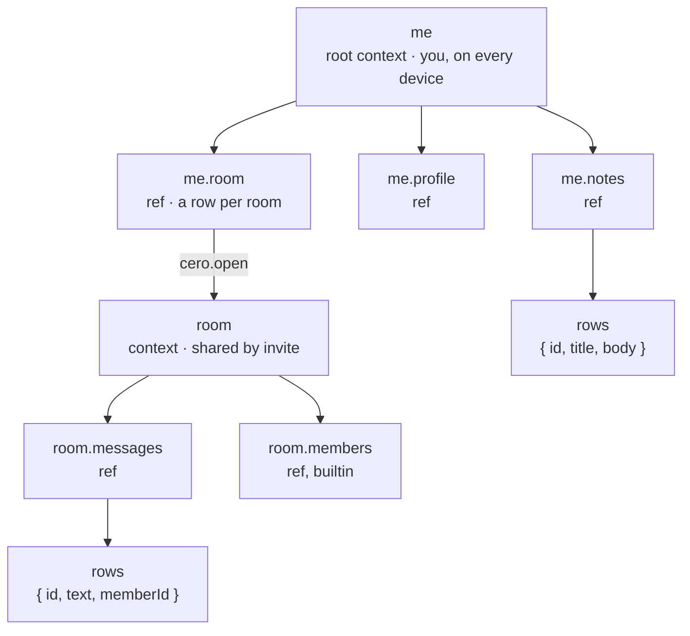
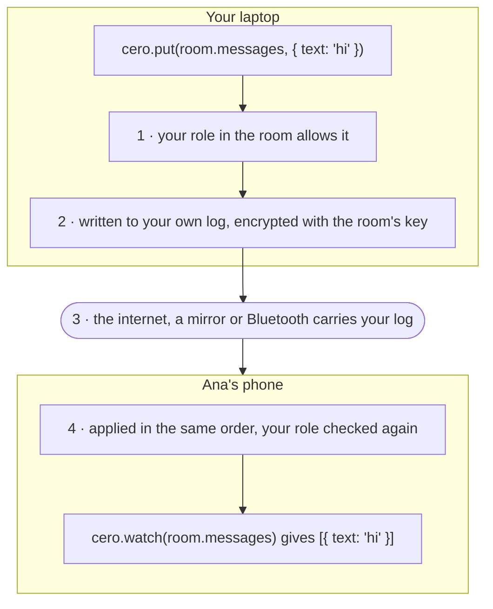

# How it works

Predict what your app shows offline, on a conflict, on a removal and on a join.

```js
// room from cero.open, as in the quickstart
for await (const { data } of cero.watch(room.status)) {
  console.log(data) // { role, writable, epoch, suspended, behind, version, nearby }
}
```

## The model

A handle is a database with its own rows, members and key, synced among its members' devices. `me`, the root, is a database only your devices share. Both are contexts: a context holds refs, a ref holds rows, and every act on them is a `cero.` verb.



## One message, from put to a friend's watch



1. **Check.** `cero.put(room.messages, { text: 'hi' })` checks your role in the handle before anything is written.
2. **Write.** The message is appended to your device's own log for the handle, encrypted with the handle's key. Every device writes only its own log.
3. **Sync.** Ana's phone copies your log: straight from you over the internet, from a mirror when you are offline, or over Bluetooth with no internet at all.
4. **Apply.** Every device applies every log in the same order and checks roles again from the log itself, so all of them end with the same rows, with no server in between. Ana's `watch` fires with the new row.

## Joining a handle

1. **Ask.** The joiner's device starts its own log for the handle and writes the join as its first entry, sealed to the handle and signed twice: by the invite, and by the joiner for that log and the address its keys go to.
2. **Reach.** The handle's peers and mirrors get that log, and any member's device with the handle open pulls it in.
3. **Admit.** Every device checks both signatures and the invite's row, and turns away a member whose removal came after the invite. Then it lets the joiner in and spends a single-use invite. The joiner becomes a member once its own device, holding the keys, takes its seat: that adds the member and the device, and lets the log write if the role writes.
4. **Keys.** Every online device of a member who can invite sends the joiner the handle's keys, directly and through mirrors, until the joiner's device has taken its seat or the invite has expired. A join turned away with an invite the handle knows, revoked, spent or older than the joiner's removal, gets `DENIED` and the reason the same way; the handle keeps a revoked or spent invite until it would have expired. A join with an invite the handle never held gets no answer.
5. **Expiry.** Past an invite's expiry, a device of a member who can remove drops the invite. A joiner whose device never took its seat never became a member.

An invite made with `confirm: true` pauses at step 3: the join waits in `room.requests` until a member who can invite accepts it, at the invite's role or lower, or denies it and the joiner gets `DENIED`. The first answer settles it everywhere.

## Your devices and recovery

A phrase is the user. Its key attests a device once, when the phrase is typed on it, and is then dropped: the device signs everything after with a key of its own, under that proof. Each device writes only its own log, in the root and in every handle, so no two devices write over each other.

A new device is linked like a member joins a handle, with the root as the handle: a device of yours mints an invite, the new one asks in with a key of its own, the request waits in `me.requests`, and the device that accepts it signs the new key into the chain and sends the root's keys. The new device then holds the identity with no phrase on it, and seats itself in each handle it opens with its proof, as a recovered device does.

When no device of yours is around, the phrase is the way in. The first device writes the root's address into a small log only the phrase can sign. A new device given the phrase reads that address from any device of yours it reaches, over the internet or Bluetooth, or from a mirror, copies the root, and admits a fresh log of its own with the proof the phrase gave its key. Each handle is a row in the root with its keys, so the device takes a seat in a handle the same way when it opens it.

Removing a device takes its logs out: from the root, and from every handle, by whichever device of yours has them open. The root rotates its key, and the removed device's key is kept beside the removed members, so it seats no new log anywhere, nor does a device it links after. `storageKey` encrypts the seed and the device's own key on disk; the keys of each database stay readable in the data directory.

## Encryption and key rotation

Each handle has its own key, made at creation, kept in your root and handed to joiners at step 4; the root's key comes from the phrase. Mirrors, and peers without the key, see only ciphertext.

A removal takes the member's logs out at once, but their key would still read what comes next. So the handle rotates its key: a new secret, sealed to each remaining device and announced in its log, for every row and file written after. A device of yours that opens the handle later reads with the keys its root carries, and is sealed to from then on.

- A removal by an admin or the owner carries the rotation: the removal goes into the log, then the new key, sealed to the devices that stay, and nothing else this device writes goes between them. When `cero.del` resolves the key is in place, and what this device writes next the removed member does not read.
- A member who leaves, or who removes a device of her own where she cannot remove members, rotates nothing: half a second after it lands, a device of an admin or the owner with the handle open rotates the key, or the next one to come online. `cero.rotate(room)` rotates it at once and resolves when the key is in place.
- A join rotates nothing: the joiner is handed the keys, and the next rotation is sealed to their device too. A join let in and then turned away, by `cero.deny`, by revoking its invite or at its expiry, rotates the key as a leave does.
- Each rotation starts an epoch, `status.epoch`. Every block names its epoch, so a reader picks the right key in any arrival order.
- A removed member never learns a new epoch. The removal lands first, so they see it: `status.role` turns `null` and what they read stops there.

A member who joins later gets every epoch's key and can read the whole history. Without mirrors, every member's device holds all of it once caught up, so any one of them online serves it; with mirrors, a device may hold only part, and the mirror holds all of it.

## Offline and conflicts

Every write lands in its device's own log first, so it shows at once and syncs when a peer is reachable. The logs merge in one order every device computes alike, each write after everything its device had seen. Writes made apart that arrive late are fitted in by undoing and applying again, so every device ends on the same rows.

The last write in that order wins, per row: `set` merges on the writing device and sends the whole row, so two offline edits to one row keep the later one whole. A write ordered after its author's removal is refused everywhere. Hooks run with every applied write, on every device and again after an undo, which is why a hook reads only its `ctx`, never a clock or local state.

## App versions

The build keeps the app's version, raising it when what is stored changes, at the root or in any handle type ([Schema](schema.md#change-a-schema-that-shipped)). Each handle, and the root, keeps the version it is at in its own data, and only an owner's device moves it forward. Every device writes as that version, and applies a write as the version it was written at: what its author's version did not have stays as stored. A device whose app is older than the handle's version skips the writes it cannot read, the same way on every such device, and `status.behind` shows the version so the app can ask for an update. Once updated, it applies the log again. Stored rows are read as they are, which is why the schema only grows. When an update of Cero changes what a write means, the updated app applies its writes again the first time it opens.

## Next

- [API reference](api.md) for every verb and status field named here.
- [Errors](errors.md) for the codes a refused write or a join returns.
- [Sharing](handles.md) for invites, roles and removal as your app uses them.
